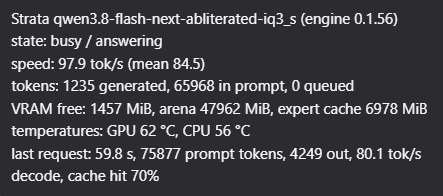

# dsh-strata-monitor

Live monitor of **Strata** model servers — local or remote — inside the DeepSeek Harness (dsh) GUI.

A pill next to the message composer shows the model's state at a glance. Hover it for the full picture.




## What it shows

| Field | Read from |
| --- | --- |
| state (`busy` / `idle` / `offline`) and phase | `GET /status` |
| live token rate, mean rate, prefill rate | `GET /status`, `GET /metrics` |
| generated and prompt tokens, queued requests, elapsed time | `GET /status` |
| model name, engine version, context size | `GET /metrics` |
| free VRAM, arena size, expert-cache size | `GET /metrics` |
| GPU temperature, CPU busy share | `GET /metrics` |
| last request: duration, prompt and output tokens, decode speed, cache hit rate | `GET /metrics` |

The panel refreshes every 5 seconds. When Strata cannot be reached, the pill
reads `offline` instead of showing stale numbers.

Note: Strata's `/metrics` carries no CPU temperature — the `hardware.cpu`
field is the CPU busy percent, and the tooltip says so.

## Multiple Strata instances

Configure as many Strata servers as you like. The pill grows a switch button,
and **each chat keeps its own choice**: one chat can watch the local model
while the neighbouring chat watches a server across the LAN. The first
configured server answers a chat that has not chosen yet, and a choice that
names a server which has gone away heals itself back to the default.

## Requirements

- DeepSeek Harness `0.2.1-rc.2` or newer (developed and tested against `0.2.2-rc.1`)
- Node.js `>=22.19`
- One or more Strata servers that answer `/status` and `/metrics` (by default `http://127.0.0.1:8080`)

## Install

```sh
dsh plugin --profile web add github:ARustamA/dsh-strata-monitor
```

Replace `web` with the profile your host actually uses, then restart the host.

## Configuration

Point the plugin at your Strata instances in the profile's patch layer
(`cordis.patch.yml`):

```yaml
- id: strata-monitor
  name: dsh-strata-monitor
  config:
    servers:
      - name: server
        url: 'http://192.168.1.140'
      - name: local
        url: 'http://127.0.0.1:8080'
```

Names are yours; the first entry is the default. Without a `servers` list
the plugin watches a single Strata at `STRATA_URL`
(environment variable, default `http://127.0.0.1:8080`).

The panel reads the server's read-only status endpoints; no API key is needed.

## How it works

The bundle has two halves:

- **Host** (`index.js`) registers one read-only route, `GET /strata/monitor`, on the
  composition's web server. `?server=<name>` picks the configured instance; the
  route reads that Strata's `/status` and `/metrics` and returns a compact
  summary that names the answered server and lists them all. Requests from
  another origin are refused, and any method other than GET or HEAD is
  answered with 405.
- **Browser** (`client.js`) renders the pill next to the composer and polls that
  route every 5 seconds. The server choice is stored per chat, keyed by the
  chat's session id.

## Development

```sh
npm test                    # node --test "test/*.test.js"
node test/mock-strata.mjs   # a stand-in for Strata on :8080, with captured payloads
```

## License

MIT — see [LICENSE](LICENSE).
