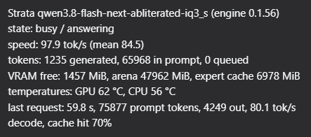

# dsh-strata-monitor

Live monitor of a local **Strata** model server inside the DeepSeek Harness (dsh) GUI.

A pill next to the message composer shows the model's state at a glance. Hover it for the full picture.




## What it shows

| Field | Read from |
| --- | --- |
| state (`busy` / `idle` / `offline`) and phase | `GET /status` |
| live token rate, mean rate, prefill rate | `GET /status`, `GET /metrics` |
| generated and prompt tokens, queued requests, elapsed time | `GET /status` |
| model name, engine version, context size | `GET /metrics` |
| free VRAM, arena size, expert-cache size | `GET /metrics` |
| last request: duration, prompt and output tokens, decode speed, cache hit rate | `GET /metrics` |

The panel refreshes every 5 seconds. When Strata cannot be reached, the pill
reads `offline` instead of showing stale numbers.

## Requirements

- DeepSeek Harness `0.2.1-rc.2` or newer (developed and tested against `0.2.2-rc.1`)
- Node.js `>=22.19`
- A Strata server that answers `/status` and `/metrics`, by default on `http://127.0.0.1:8080`

## Install

```sh
dsh plugin --profile web add github:ARustamA/dsh-strata-monitor
```

Replace `web` with the profile your host actually uses, then restart the host.

## Configuration

| Variable | Default | Meaning |
| --- | --- | --- |
| `STRATA_URL` | `http://127.0.0.1:8080` | Base URL of the Strata server |

The panel reads the server's read-only status endpoints; no API key is needed.

## How it works

The bundle has two halves:

- **Host** (`index.js`) registers one read-only route, `GET /strata/monitor`, on the
  composition's web server. It reads Strata's `/status` and `/metrics` and returns a
  compact summary. Requests from another origin are refused, and any method other
  than GET or HEAD is answered with 405.
- **Browser** (`client.js`) renders the pill next to the composer and polls that
  route every 5 seconds.

## Development

```sh
npm test                    # node --test "test/*.test.js"
node test/mock-strata.mjs   # a stand-in for Strata on :8080, with captured payloads
```

## License

MIT — see [LICENSE](LICENSE).
